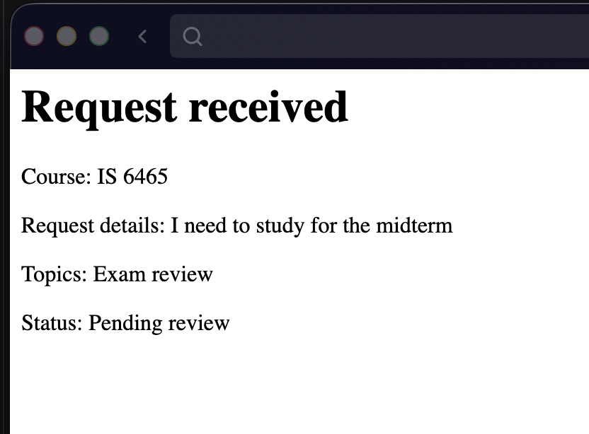
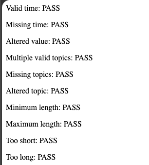

# Lab 4 Notes

## Part 1: Run the Application

I opened the application in Codespaces and navigated to `request-form.php`. I completed and submitted a valid tutoring request.

After submitting the form, the application displayed a confirmation page with the heading **Request received**.

The confirmation page showed the following information:

- **Course:** IS 6465
- **Request details:** I need to study for the midterm
- **Topics:** Exam review
- **Status:** Pending review

This confirms that the form submission was processed and the request is pending review.

### Screenshot

## Part 2: Trace the Templates

### 1. What content does header.php provide to every page?

`header.php` provides the beginning of the HTML document, including:

- The `<!doctype html>` declaration
- The opening `<html lang="en">` tag
- The `<head>` section, including the page title and shared CSS link
- The opening `<body>` tag

### 2. What content does nav.php provide?

`nav.php` provides the shared navigation links displayed in the page header.

### 3. What content does footer.php provide?

`footer.php` provides the shared footer content and the closing `</body>` and `</html>` tags.

### 4. Why is require_once appropriate for these files?

`require_once` ensures that each shared file is included only once during a single page request, preventing duplicate content. It also stops execution if a required file cannot be loaded.

### 5. Where is the shared CSS file linked?

The shared CSS file is linked through a `<link>` element in the `<head>` section of `header.php`.

## Part 3: Observe the Form Controls

### 1. `reason`

A text area where the user explains why they need tutoring and what they would like help with.

**Value PHP receives:** A string in `$_POST['reason']`, such as `"I need to study for the midterm"`.

### 2. `topics[]`

A group of checkboxes that allows the user to select tutoring topics, such as Exam review, Practice problems, and Study plan.

**Value PHP receives:** An array of selected strings in `$_POST['topics']`, such as `["Exam review", "Study plan"]`. If no boxes are checked, this field is not submitted.

### 3. `preferredtime`

A group of radio buttons that allows the user to select one preferred time of day: Morning, Afternoon, or Evening.

**Value PHP receives:** A string in `$_POST['preferredtime']`, such as `"Morning"`.

### 4. `preferreddate`

A date input where the user selects the day they would like to have the tutoring session.

**Value PHP receives:** A string in `$_POST['preferreddate']` formatted as `YYYY-MM-DD`, such as `"2026-10-27"`.

### 5. `form_name`

A hidden input that identifies the submitted form as a tutoring request.

**Value PHP receives:** The string `"tutoring_request"` in `$_POST['form_name']`.

## Part 4: Test validation behavior

#### 1. Valid Request

- **Values entered:**
  - Course: IS 6465
  - Reason: I need to study for the midterm
  - Topics: Exam review
  - Preferred time: Morning
  - Preferred date: 2026-11-01
  - Hidden form name: tutoring_request
- **Result:** Accepted.
- **Message displayed:** "Request received", followed by the course, request details, selected topics, and "Status: Pending review".
- **Business rule checked:** The request must include an allowed course and time, a reason between 10 and 500 characters, at least one valid topic, today or a future date, and the correct form identifier.

#### 2. Missing or Invalid Value

- **Values entered:** Same as the valid request, except no topics were selected.
- **Result:** Rejected.
- **Message displayed:** "Request could not be submitted" and "Select at least one valid topic."
- **Business rule checked:** At least one valid tutoring topic must be selected.

#### 3. Past Date

- **Values entered:** Same as the valid request, except the preferred date was 2026-10-26.
- **Result:** Rejected.
- **Message displayed:** "Request could not be submitted" and "Preferred date cannot be in the past."
- **Business rule checked:** The preferred tutoring date must be today or a future date.

## Part 5: Review Testing and CRUD Pages

### Validation Test Results

All 10 tests passed. A passing test means the validation function returned the expected result, including rejecting invalid input.

### Requests and Request Details

`requests.php` lists the tutoring requests and provides a View link for each one.

For example, `request-details.php?request_id=12` displays request 12, including its course, request details, preferred date and time, topics, and status.

### CRUD Pages

| CRUD action | Page |
| --- | --- |
| Create | `request-form.php`, submitted to `process-request.php` |
| Read one request | `request-details.php` |
| Read all requests | `requests.php` |
| Update | `edit-request.php` |
| Delete | `delete-request.php` |

The update and delete pages currently represent those actions through forms; they do not yet save changes or delete stored requests.

### 1. What query parameter appears in the request details URL?

The query parameter is `request_id`. For example, `request-details.php?request_id=12` identifies request 12.

### 2. Why is a GET query parameter appropriate for viewing one request?

Viewing a request retrieves information without changing it. A GET query parameter identifies which request to display and allows the URL to be bookmarked or shared.

### 3. Why should an actual update or delete later use POST rather than GET?

Updates and deletions change stored data. GET requests should only retrieve information because links can be followed automatically by browsers, crawlers, or prefetching tools. POST allows changes to be submitted deliberately through a form.

The server must still validate the submitted data, check authorization, and protect against cross-site request forgery.