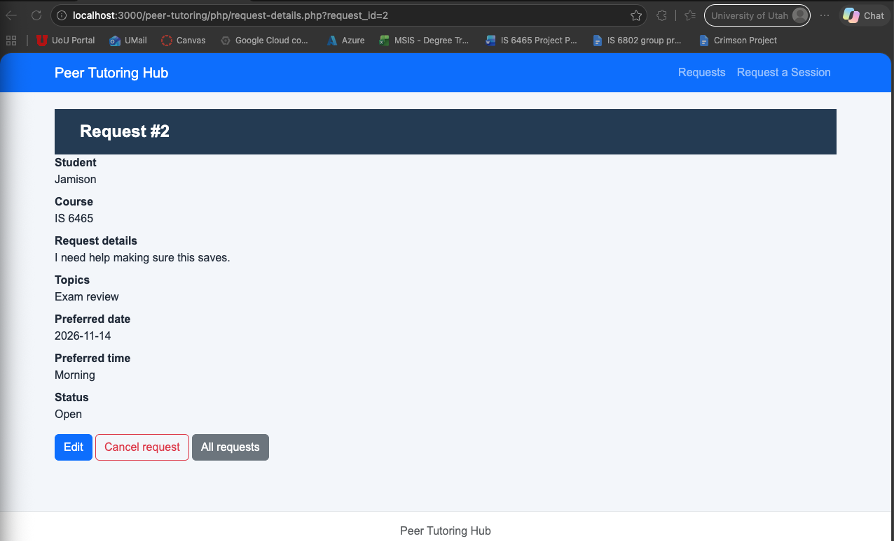
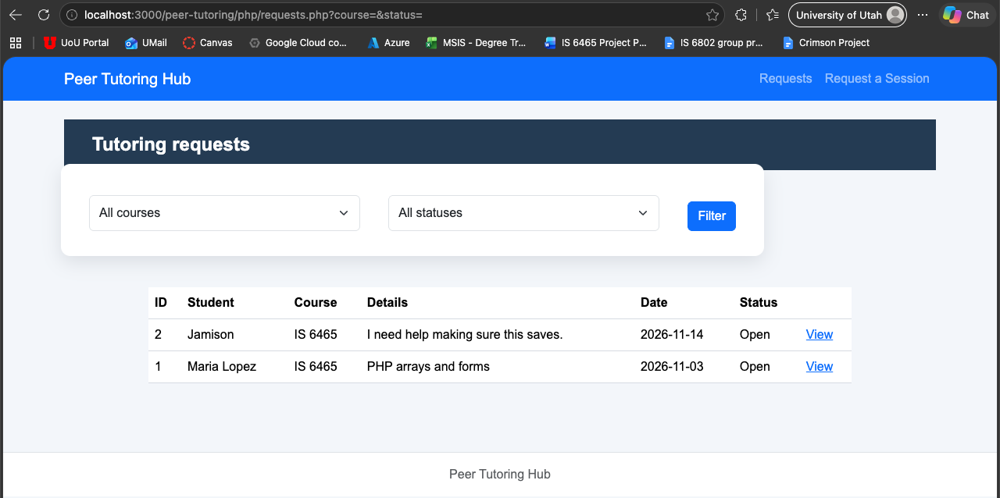
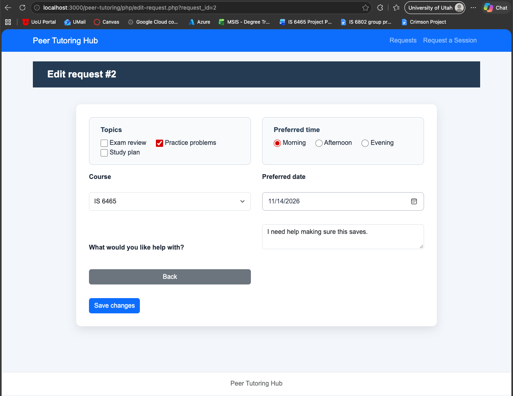
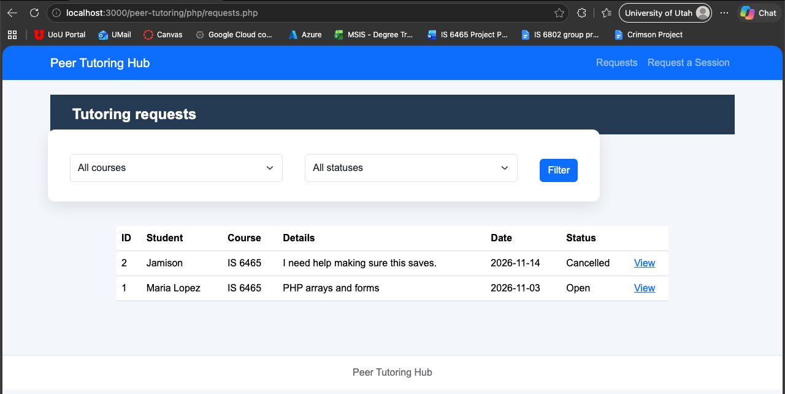
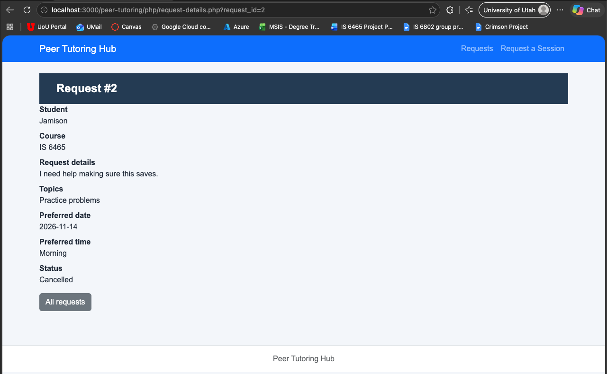
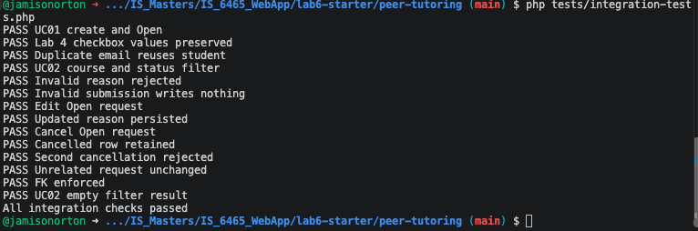
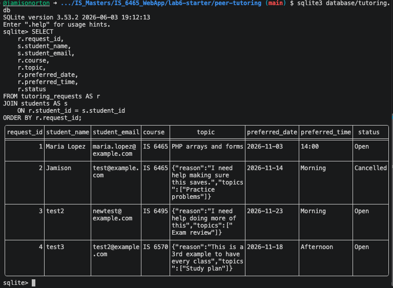

# Lab 6 Notes

## Part 1: Set Up the Database

From the `lab6` project root, the database was opened with:

```bash
sqlite3 database/tutoring.db
```

The terminal screenshot shows successful `SELECT` queries against both `students` and `tutoring_requests`, confirming that both tables exist and contain rows. It does not show the setup command or the `.tables` output, so those steps are not claimed here.

## Part 2: Run the Application

The browser screenshot shows the request detail page at:

`http://localhost:3000/peer-tutoring/php/request-details.php?request_id=2`

Request #2 was saved and displayed on its detail page. The terminal screenshot also shows a row with `request_id` 2 in `tutoring_requests`.



## Part 3: Test the Application Workflows

| Test                                      | What I Did                                                                           | Expected Result                                        | Actual Result                                                                                                      | Pass or Fail |
| ----------------------------------------- | ------------------------------------------------------------------------------------ | ------------------------------------------------------ | ------------------------------------------------------------------------------------------------------------------ | ------------ |
| Submit a valid request                    | Submitted a valid tutoring request using test data.                                  | A new tutoring request is created with status `Open`.  | Request #2 appeared in the request list with status `Open`.                                                        | Pass         |
| View all requests                         | Opened the requests page.                                                            | The new request appears in the request list.           | Request #2 appeared in the list with its course, details, date, and `Open` status.                                 | Pass         |
| Filter requests                           | Filtered requests by course and by status.                                           | Filtering by course or status shows matching requests. | The matching requests were shown for the selected course and status.                                               | Pass         |
| Edit an Open request                      | Edited request #2, changing its topic to “Practice problems,” and saved the changes. | The revised values are displayed.                      | The edit form showed “Practice problems” selected, and the request detail page displayed the revised topic.        | Pass         |
| Cancel an Open request                    | Cancelled request #2.                                                                | The request status changes to `Cancelled`.             | Request #2 appeared with status `Cancelled` in both the request list and detail page.                              | Pass         |
| Try to edit or cancel a cancelled request | Opened the detail page for cancelled request #2 and checked the available actions.   | The application does not allow the change.             | The cancelled request detail page showed no Edit or Cancel request controls; the request could not be uncancelled. | Pass         |

### Part 3 Screenshots









## Part 4: Trace the Request Submission Workflow

1. **Which file displays the tutoring request form?** `php/request-form.php`
2. **Which file receives the submitted form data?** `php/process-request.php`
3. **Which file opens the PDO connection to SQLite?** `config/db.php`
4. **Which file coordinates validation and the database transaction?** `services/requestService.php`
5. **Which files contain the SQL statements?** `repositories/studentPDO.php` and `repositories/requestPDO.php` contain the student and request queries. `database/setup-database.sql` contains the schema and initial data statements.
6. **Which table stores student information?** `students`
7. **Which table stores tutoring requests?** `tutoring_requests`
8. **How does a tutoring request connect to the student who submitted it?** `tutoring_requests.student_id` is a foreign key referencing `students.student_id`.

The request form should focus on displaying fields and collecting input, while repository files keep database operations in one place. The repositories use prepared statements with bound values, which helps prevent SQL injection; simply moving SQL out of the form would not by itself stop injection. This separation also makes the database code easier to review and reuse.

## Part 5: Run the Integration Tests

Command run from the project root:

```bash
php tests/integration-tests.php
```

Complete output:

```text
PASS UC01 create and Open
PASS Lab 4 checkbox values preserved
PASS Duplicate email reuses student
PASS UC02 course and status filter
PASS Invalid reason rejected
PASS Invalid submission writes nothing
PASS Edit Open request
PASS Updated reason persisted
PASS Cancel Open request
PASS Cancelled row retained
PASS Second cancellation rejected
PASS Unrelated request unchanged
PASS FK enforced
PASS UC02 empty filter result
All integration checks passed
```




## Part 6: Use the AI Skills Pack Process

### Application Builder

**Prompt**

> Explain how a tutoring request moves from `php/request-form.php` through PHP, PDO, and SQLite in this project. Identify the responsibility of each file.

**AI response**

`php/request-form.php` displays the fields and sends them by POST to `php/process-request.php`. The process file checks the request method and form name, opens the PDO connection through `config/db.php`, and calls `submitRequest()` in `services/requestService.php`. The service validates the input, starts a transaction, asks `repositories/studentPDO.php` to find or insert the student, then asks `repositories/requestPDO.php` to insert the tutoring request; it commits on success and rolls back on an error. The repository files use prepared SQL statements, and `database/setup-database.sql` defines the `students` and `tutoring_requests` tables, including their foreign-key relationship.

**Evaluation and code check**

One accurate statement is that `php/process-request.php` calls `submitRequest(openDatabase(), $_POST)` after checking the POST method and form name. I verified this in that file; `services/requestService.php` then calls validation, begins the transaction, performs the student and request operations, and commits or rolls back.

### Traceability Auditor

**Prompt**

> Trace the requirement “a student can submit a tutoring request” through the PHP files, service, repositories, SQLite tables, and integration tests in this project.

**AI response and evidence table**

| Requirement                        | Application Page                                          | Service or Validation                                                                                                                                     | Repository or SQL                                                                                                                                        | Database Table                                                                                      | Test Evidence                                                                                                                                 |
| ---------------------------------- | --------------------------------------------------------- | --------------------------------------------------------------------------------------------------------------------------------------------------------- | -------------------------------------------------------------------------------------------------------------------------------------------------------- | --------------------------------------------------------------------------------------------------- | --------------------------------------------------------------------------------------------------------------------------------------------- |
| Student submits a tutoring request | `php/request-form.php` posts to `php/process-request.php` | `services/requestService.php`: `submitRequest()` calls `validateSubmission()`; `includes/validation.php` validates the reason, topics, and preferred time | `repositories/studentPDO.php` finds/inserts a student; `repositories/requestPDO.php` inserts a request; `database/setup-database.sql` defines the schema | `students` and `tutoring_requests`; `tutoring_requests.student_id` references `students.student_id` | `tests/integration-tests.php`: `UC01 create and Open`, `Lab 4 checkbox values preserved`, `Duplicate email reuses student`, and `FK enforced` |

**Evaluation**

The trace matches the code: the form action names `process-request.php`; that handler calls `submitRequest`; the service invokes the validation and repository functions; and the request insert uses the student ID. The integration test labels listed in the table are present in `tests/integration-tests.php` and check creation, topic preservation, duplicate-student handling, and foreign-key enforcement.

### Test Harness Generator

**Prompt**

> Suggest one useful test case for the Peer Tutoring Hub application. The test must relate to request creation, filtering, editing, cancellation, validation, or database integrity.

**AI response**

Add a test that verifies a cancelled request cannot be edited: cancel an open request, attempt to revise it, and confirm that the update is rejected and its stored values remain unchanged.

**Evaluation**

1. This case is not currently covered by `tests/integration-tests.php`. The file checks that a second cancellation is rejected, but it does not attempt `reviseRequest()` after cancellation.
2. To add it, call `reviseRequest($pdo, $id, $edit)` after cancelling the request and assert it returns `false`. Then fetch the row with `findRequest()` and confirm its status remains `Cancelled` and its saved topic is unchanged. Manually, the same behavior can be checked by trying to submit an edit for a cancelled request and confirming that the application rejects it; `php/update-request.php` returns a conflict response when `reviseRequest()` reports no open request.
3. This is appropriate because the repository's `updateOpenRequest()` SQL only updates rows whose status is `Open`, so a cancelled request should not be editable.

### Skills Pack Reflection

The AI responses helped map the request from the browser form through the handler, service, repositories, and database. The traceability table made it easier to see which code and test support the submission requirement. AI output can sound convincing while naming the wrong file or overstating what a test proves, so I checked each claim against the PHP, SQL, and integration test code. That verification also revealed a useful missing test for editing a cancelled request.

## Part 7: Inspect the Database

The query joins `tutoring_requests` (`r`) to `students` (`s`) by matching `r.student_id` with `s.student_id`. This combines each request row with the name and email of the student who submitted it, so the results show request details and student information together. Because this is an inner `JOIN`, any request without a matching student row would be excluded.

