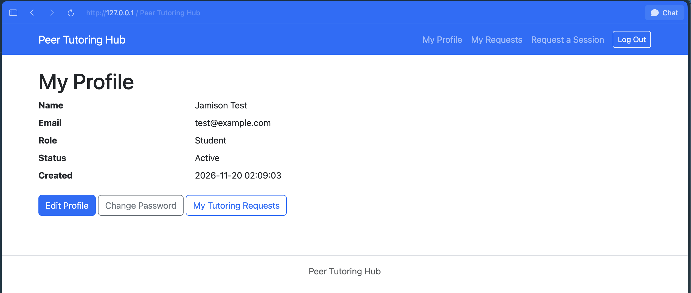
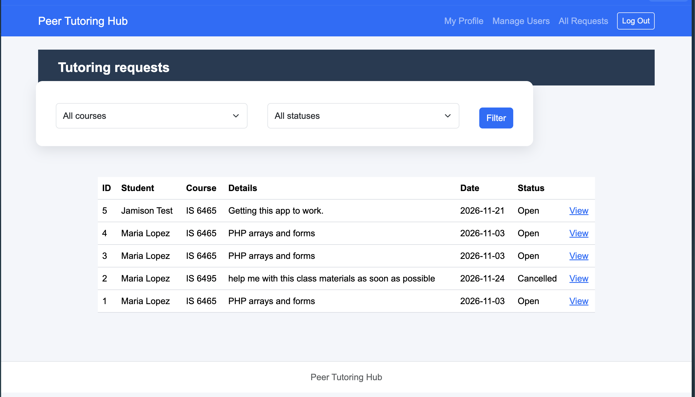
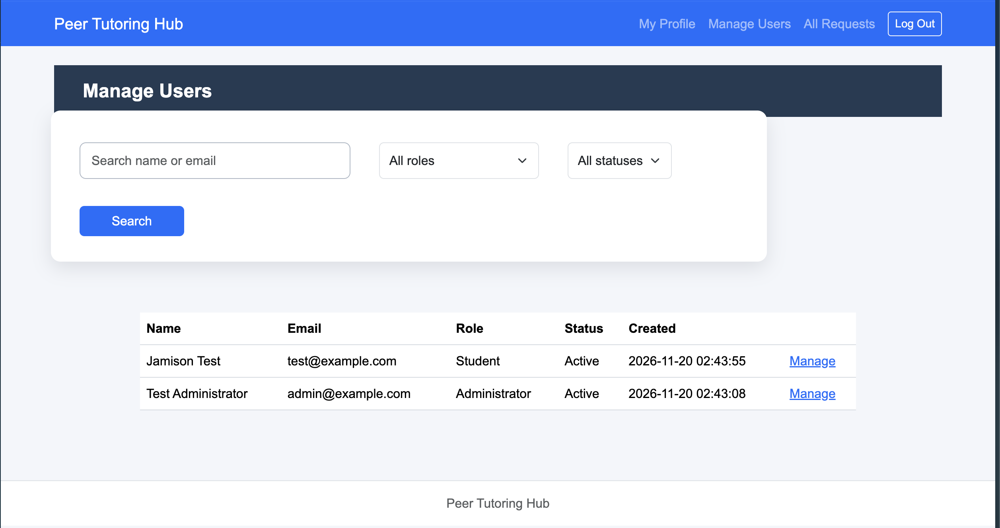
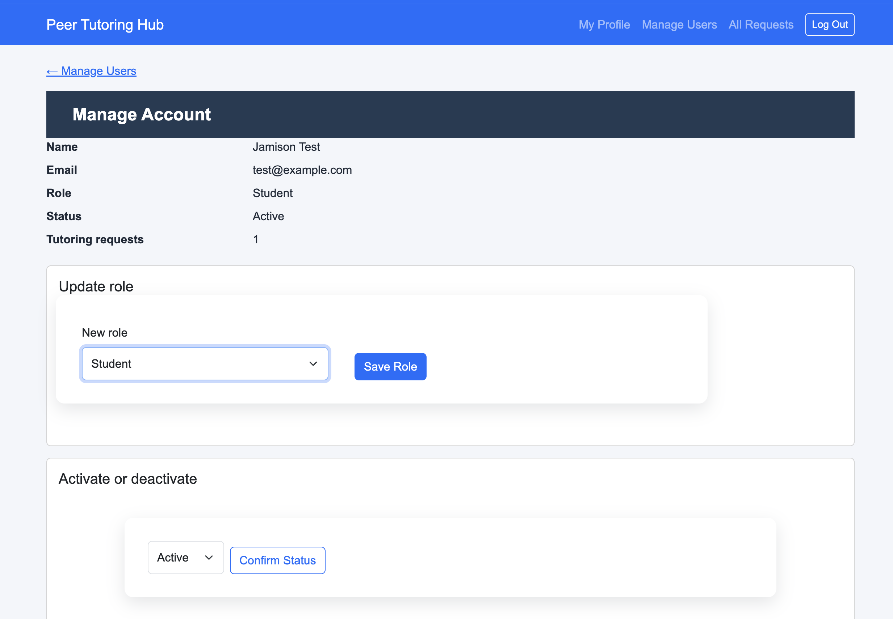

# Lab 7 Implementation Notes
## Part 1: Generate the Lab 7 Application
## AI prompt used

> Generate code for all user management use cases UM-01 through UM-10 in the User Management Design Document.
>
> Use the Application Builder, Test Harness Generator, and Traceability Auditor documents as implementation guidance. Follow the authentication, authorization, session management, password hashing, CSRF protection, and role based access practices in the Authentication Reading Handout.
>
> Use lab6.zip as the existing Peer Tutoring Hub application to extend. Preserve the Lab 6 three tier architecture and update the application as needed to support user registration, login, logout, profile management, administrator access, and protected tutoring request workflows.
>
> Return a complete Lab 7 application package with all updated and new files.

## Uploaded source files

- `application-builder.txt`
- `IS6465_Authentication_Reading_Handout_v1.2_[16Nov2026].pdf`
- `lab6.zip`
- `Peer_Tutoring_Hub_User_Management_With_Diagrams.docx`
- `test-harness-generator.txt`
- `traceability-auditor.txt`

## How Lab 7 extends Lab 6

Lab 7 keeps the existing PHP, PDO, and SQLite three tier structure and tutoring request tables. It adds a `users` table for account credentials, roles, and statuses, connected to the existing `students` records through `students.user_id`. New pages and services support Student/Tutor registration, login/logout, own-profile and password changes, and Administrator user search and management. The existing tutoring request flow now requires authentication: Students can manage their own requests, Administrators can review all requests, and Tutors are denied request access.

## Example checked against the design and handout

In `includes/auth.php::requireLogin()`, protected requests check for a signed-in user, end sessions after 1,200 seconds of inactivity, reload the account from SQLite, and reject missing or inactive accounts. The helper then refreshes the session's display name and role from the database. I checked this implementation against the Authentication Reading Handout's reusable session-check example, which requires a 20-minute inactivity timeout and a fresh account/status/role check on every protected request.

## Verification note

PHP syntax checks passed for the package. The CLI test scripts are included but were not run, so runtime behavior has not been verified.

## Part 2: Set Up the Database

Open a terminal in GitHub Codespaces and move into the Lab 7 database folder:

```bash
cd lab7/database
```

Create the Lab 6 database structure:

```bash
sqlite3 tutoring.db < setup-database.sql
```

Upgrade the database for user management:

```bash
sqlite3 tutoring.db < upgrade-to-user-management.sql
```

Open the database and list its tables:

```bash
sqlite3 tutoring.db
```

At the SQLite prompt:

```text
@jamisonorton ➜ .../IS_Masters/IS_6465_WebApp/lab7/database (main) $ sqlite3 tutoring.db < setup-database.sql
@jamisonorton ➜ .../IS_Masters/IS_6465_WebApp/lab7/database (main) $ sqlite3 tutoring.db < upgrade-to-user-management.sql
@jamisonorton ➜ .../IS_Masters/IS_6465_WebApp/lab7/database (main) $ sqlite3 tutoring.db
SQLite version 3.53.2 2026-06-03 19:12:13
Enter ".help" for usage hints.
sqlite> .tables
students     tutoring_requests     users
sqlite> .quit
```

**Confirmation:** The Codespaces terminal output above shows all three expected tables: `students`, `tutoring_requests`, and `users`.

## Part 3: Create an Administrator Account

From the `lab7/database` folder, I used this command structure. The password is redacted:

```bash
php create-admin.php "Test Administrator" admin@example.com "<12+ character test password>"
```

The script prompted for the account details in that run. It confirmed: `Administrator account created with user ID 1.`

- **Test account email:** `testingadmin@example.com`
- **Assigned role:** Administrator

## Part 4: Run the Application

From the `lab7/database` folder, return to the `lab7` project root and start the PHP development server:

```bash
cd ..
php -S 0.0.0.0:8000
```

Open port 8000 in the browser.

- **Browser URL opened:** [http://127.0.0.1:8000/IS_6465_WebApp/lab7/php/login.php](http://127.0.0.1:8000/IS_6465_WebApp/lab7/php/login.php)
- **Result:** The Peer Tutoring Hub application opened successfully.
- **Unauthenticated access:** When I first accessed a protected page without logging in, the application redirected me to the login page instead of showing protected content.

## Part 5: Test the Student Workflow

I completed the student workflow after correcting the navbar links to preserve the application's folder path. All listed activities succeeded.

| Test | What I Did | Expected Result | Actual Result | Pass or Fail |
|---|---|---|---|---|
| Register student account | Registered Jamison Test with a test account. | Student account is created. | Student account was created and shown as Active. | Pass |
| Log in as student | Logged in with the student account. | Student can access protected student pages. | Login succeeded and the student profile opened. | Pass |
| View or update profile | Opened My Profile. | Profile information is displayed or saved. | Profile information was displayed (see screenshot). | Pass |
| Create tutoring request | Opened Request a Session and submitted the form. | A new request is created with status `Open`. | Request was created with status `Open`. | Pass |
| Edit Open request | Edited the Open tutoring request and saved the changes. | Updated request information is displayed. | Changes were saved and the updated request was displayed. | Pass |
| View my requests | Opened My Requests. | Student sees the student’s own requests. | The student's request list displayed the request. | Pass |
| Log out | Selected Log Out. | Session ends and login page appears. | Session ended and the login page appeared. | Pass |



## Part 6: Test the Administrator Workflow

I logged in with the administrator account and verified the user-management and all-requests pages. The screenshots show the administrator viewing multiple users, requests from more than one student, and account-management controls. I also verified the administrator can make account edits and log out.

| Test | What I Did | Expected Result | Actual Result | Pass or Fail |
|---|---|---|---|---|
| Log in as administrator | Signed in with the administrator account from Part 3. | Administrator can access protected administration pages. | Administrator pages and navigation were available after login. | Pass |
| View the user list | Opened Manage Users. | Administrator can view and search user accounts. | The list showed the Student and Administrator accounts (see screenshot). | Pass |
| View tutoring requests | Opened All Requests. | Administrator can view tutoring requests. | The list showed requests from multiple students (see screenshot). | Pass |
| Confirm access beyond one student's data | Compared the user list and request list. | Administrator can view information beyond one student's own account and requests. | The administrator could see multiple user accounts and requests belonging to different students. | Pass |
| Edit/manage an account | Opened Manage for a student account and used the administrator controls. | Administrator can make permitted account edits. | The account-management page exposed role and status controls (see screenshot); the administrator workflow was verified. | Pass |
| Log out | Selected Log Out. | Session ends and login page appears. | Logout succeeded; protected pages require signing in again. | Pass |

### Authentication and authorization

1. **Authentication** verifies who a user is. In this application, the login page checks the submitted email and password against the stored password hash; a successful login establishes a server-side session.
2. **Authorization** determines which pages and records that authenticated user may access. The application checks the user's current role, account status, and record ownership on protected requests.
3. **Student vs. Administrator access:** Students can manage their own profile and tutoring requests. Administrators can search and manage accounts and view tutoring requests across students. Tutors can manage their profiles but are denied the student request workflow.
4. **Administrator-only functions and pages:** `php/admin/users.php` and `php/admin/user.php` restrict user search, account details, role changes, status changes, and permitted account deletion to Administrators. The all-requests view and management of other students' Open requests are also administrator-only.
5. **After logout:** The application clears the session and expires its cookie. Visiting a protected page directly then redirects the signed-out user to the login page.







## Part 7: Trace Registration and Login

### Student registration workflow

1. **Create Account form:** `php/register.php` displays the registration form.
2. **Registration submission:** `php/register.php` also receives the form's POST request and acts as the registration controller.
3. **CSRF:** `includes/auth.php::csrfToken()` creates the token; `verifyCsrfToken()` checks the submitted token.
4. **Validation:** `services/userService.php::registerUser()` calls `validateUserProfile()` and `validateNewPassword()`, checks that the passwords match, and only allows Student or Tutor roles.
5. **Password hashing:** `registerUser()` hashes the password with `password_hash(PASSWORD_DEFAULT)` before sending it to the repository.
6. **Insert repositories:** `repositories/userPDO.php::createUserRecord()` inserts the user. For a Student registration, `repositories/studentPDO.php::linkStudentToUser()` creates or links the student record.
7. **Tables written:** `users` receives every new account. `students` also receives or links a record when the selected role is Student. Registration does not create a tutoring request.

Flow: Browser → `php/register.php` → session and CSRF checks → `registerUser()` → user/student repositories → SQLite.

### User login workflow

1. **Login form:** `php/login.php` displays the login form.
2. **Credential submission:** `php/login.php` also receives the form's POST request and acts as the login controller.
3. **Find account:** `repositories/userPDO.php::findUserByEmail()` retrieves the account by email using a prepared statement.
4. **Verify password:** `services/userService.php::authenticateUser()` checks the submitted password with `password_verify()` and also requires an Active account.
5. **Session actions:** On success, `login.php` calls `session_regenerate_id(true)`, stores `user_id`, `display_name`, `role`, and `last_activity` in the server-side session, replaces the CSRF token, and redirects to the profile.
6. **Why regenerate the ID:** Regenerating the session ID after authentication helps prevent session fixation by invalidating the pre-login identifier.
7. **Determine the role:** The role comes from the user record retrieved from SQLite, is stored in the server-side session, and is refreshed from the database by `requireLogin()` on protected requests. The application does not trust a role supplied by the browser.

Flow: Browser → `php/login.php` → session and CSRF checks → `authenticateUser()` → user repository → SQLite → regenerated authenticated session.

Password hashing and verification belong in the application service layer because that is where the application validates credentials and applies PHP's password APIs. The presentation page should collect and submit credentials, while SQLite should store only the resulting hash rather than perform authentication. Keeping the password logic in the service and the hash storage in the repository makes the responsibilities clearer and the behavior easier to test.

## Part 8: Run the Automated Tests

I ran all three commands from the updated Lab 7 package root. The test files were not changed.

### Validation tests — Passed

Command: `php tests/validation-tests.php`

```text
<p>Valid time: PASS</p><p>Missing time: PASS</p><p>Altered value: PASS</p><p>Multiple valid topics: PASS</p><p>Missing topics: PASS</p><p>Altered topic: PASS</p><p>Minimum length: PASS</p><p>Maximum length: PASS</p><p>Too short: PASS</p><p>Too long: PASS</p>
```

Result: 10 validation checks passed.

### User management tests — Passed

Command: `php tests/user-management-tests.php`

```text
PASS: UM-01 Student account is Active
PASS: UM-01 only a verified password hash is stored
PASS: UM-01 student account links to the existing STUDENTS entity
PASS: UM-01 duplicate email is rejected
PASS: UM-01 Tutor account is supported
PASS: UM-06 invalid role value is rejected
PASS: UM-09 valid credentials authenticate
PASS: UM-09 invalid password is rejected
PASS: UM-06 role change to Student provisions a linked student record
PASS: UM-07 and UM-09 inactive account cannot authenticate
PASS: UM-04 profile fields can be updated
PASS: UM-05 new password works
PASS: UM-05 old password no longer works
PASS: UM-08 account with related tutoring requests cannot be deleted
PASS: UM-08 blocked deletion retains the tutoring request
PASS: UM-07 last active administrator is protected
PASS: UM-08 last active administrator cannot be deleted
PASS: UM-03 admin search filters name and status
PASS: Rejected changes do not add accounts
Results: 19 passed, 0 failed
```

Result: 19 user management checks passed; 0 failed.

### Integration tests — Passed after compatibility fixes

Command: `php tests/integration-tests.php`

```text
PASS UC01 create and Open
PASS Lab 4 checkbox values preserved
PASS Duplicate email reuses student
PASS UC02 course and status filter
PASS Invalid reason rejected
PASS Invalid submission writes nothing
PASS Edit Open request
PASS Updated reason persisted
PASS Cancel Open request
PASS Cancelled row retained
PASS Second cancellation rejected
PASS Unrelated request unchanged
PASS FK enforced
PASS UC02 empty filter result
All integration checks passed
```

Result: 14 integration checks passed; 0 failed.

### First integration failure and investigation

The first Codespaces run failed during the initial request-creation check, before that check could print its result. The trace pointed to `repositories/studentPDO.php::findStudentByEmail()`: it selected `students.user_id`, but the integration test's in-memory database used the Lab 6 schema, which does not contain that column. A local reproduction also exposed test-count checks being affected by seeded sample rows and an ownership-scoped update being applied when no authenticated user ID was supplied.

I kept the test files unchanged. I made the email lookup compatible with the original Lab 6 columns, kept ownership filtering when an authenticated user ID is supplied, and removed seed rows from the schema setup file so the in-memory fixture starts empty. After those changes, the integration command completed with all 14 checks passing. The passing outputs above are from the updated package; rerun the commands in Codespaces after copying these updates to confirm the same results there.

## Part 9: Use the AI Skills Pack Process

### Application Builder

**Prompt**

```text
Explain how a student registration request moves from register.php through authentication checks, PHP services, repositories, PDO, and SQLite in the Peer Tutoring Hub application. Identify the responsibility of each file or layer.
```

**AI response**

The browser sends the registration form to `php/register.php`, which handles both displaying the form and receiving its POST. Registration is public, so the user is not logged in yet; the page starts a session and checks the CSRF token with `includes/auth.php::verifyCsrfToken()`. It passes the submitted data to `services/userService.php::registerUser()`, where name, email, password length, password confirmation, and the Student/Tutor role are validated. The service hashes the password and opens a transaction, then `repositories/userPDO.php::createUserRecord()` inserts the account into `users`; for a Student role, `repositories/studentPDO.php::linkStudentToUser()` creates or links the matching `students` row. The PDO connection in `config/db.php::openDatabase()` enables SQLite foreign keys and handles the schema migration; the service commits the transaction and the page redirects to login.

**Evaluation and code check**

One accurate statement is that `registerUser()` hashes the password before calling `createUserRecord()`. I verified this in `services/userService.php`: the call passes `password_hash($password, PASSWORD_DEFAULT)` as the hash argument, and `repositories/userPDO.php::createUserRecord()` inserts that value into `users.password_hash`. The CSRF check is a request-integrity check; it does not authenticate the registering visitor.

### Traceability Auditor

**Prompt**

```text
Trace the requirement “a student can register, log in, create a tutoring request, and log out” through the presentation pages, authentication code, services, repositories, SQLite tables, and automated tests in this project.
```

**AI response**

Registration flows through `php/register.php`, CSRF verification, `registerUser()`, and the user/student repositories into `users` and `students`. Login flows through `php/login.php`, CSRF verification, `authenticateUser()`, and `findUserByEmail()`; a valid Active account receives a regenerated session. A student request is submitted by `php/process-request.php`, which requires an authenticated Student, checks CSRF, calls `submitRequest()`, and writes through the student and request repositories into `students` and `tutoring_requests`. Logout is a CSRF-protected POST to `php/logout.php`, which calls `logoutSession()` to clear the session and cookie. Automated tests cover account creation/login and request business rules; manual checks cover the browser workflows, while cross-account ownership and browser session behavior remain gaps in automated coverage.

**Requirements traceability**

| Requirement | Presentation Page | Authentication or Authorization | Service or Validation | Repository or SQL | Database Table | Test Evidence |
|---|---|---|---|---|---|---|
| Student registers an account | `php/register.php` (GET form and POST handler) | `includes/auth.php::verifyCsrfToken()`; public registration only permits Student/Tutor in `registerUser()` | `services/userService.php::registerUser()`, `validateUserProfile()`, `validateNewPassword()` | `repositories/userPDO.php::createUserRecord()`; `repositories/studentPDO.php::linkStudentToUser()` | `users`; `students` for Student role | `tests/user-management-tests.php`: Active Student, hash, student link, duplicate rejection; passed |
| Student logs in | `php/login.php` (GET form and POST handler) | CSRF verification; Active status and password verification; session ID regenerated | `services/userService.php::authenticateUser()` | `repositories/userPDO.php::findUserByEmail()`, `findUserById()` | `users` | `tests/user-management-tests.php`: valid/invalid password and inactive account checks; passed |
| Student creates a tutoring request | `php/request-form.php`, `php/process-request.php` | `requireLogin()`, `requireRole(..., ['Student'])`, CSRF check | `services/requestService.php::submitRequest()`, `validateSubmission()` | `repositories/studentPDO.php::findStudentByUserId()`; `repositories/requestPDO.php::insertTutoringRequest()` | `students`; `tutoring_requests` | `tests/integration-tests.php`: create/Open and saved row behavior; passed. Part 5 browser workflow also passed. |
| User logs out | `php/logout.php`; POST form in `includes/nav.php` | CSRF check; logout is POST-only | `includes/auth.php::logoutSession()` | No application repository write; PHP session storage and cookie are cleared | No SQLite table; PHP server session | No automated logout test. Part 5 manual browser test passed; direct protected-page denial is implemented by `requireLogin()`. |

### Test Harness Generator

**Prompt**

```text
Suggest one useful test case for authentication or authorization in the Peer Tutoring Hub application. The test must relate to registration, login, logout, session protection, role based access, password validation, CSRF protection, or account status.
```

**AI response**

Test that a Student cannot view another Student's tutoring request. Create two Student accounts and a request owned by the first account, then attempt to open that request while signed in as the second account. The application should return not found and expose no request details.

**Evaluation**

1. This cross-account ownership case is not covered by the current automated test files. The integration tests exercise request creation, editing, cancellation, and filtering, but they do not authenticate two users and test request ownership.
2. Manually, create two Student accounts, submit a request as Student A, sign in as Student B, and open Student A's request URL; expect a not-found response. To automate it later, create both users and the request in an in-memory SQLite database, call `findRequestForUser($pdo, $requestId, $studentBId, false)`, and assert it returns no row. No test file was changed for this notes update.
3. The suggested test is appropriate: the handout requires record-level ownership checks, and the request details query includes the authenticated user's ID so the database returns only that user's request.

### Skills Pack Reflection

The AI explanations helped me follow how a form request moves from the page to services, repositories, and SQLite. The traceability table made it easier to connect each requirement to code and test evidence. The test suggestion highlighted that request rules passing in integration tests does not prove student ownership is enforced. Developers must compare AI explanations, code, and tests with the approved requirements and actual source because generated answers can overlook gaps or describe behavior that the project does not implement.

## Part 10: Inspect the Database

From the `lab7` project root, I opened the SQLite database and ran the query:

```sql
SELECT
    u.user_id,
    u.full_name,
    u.email,
    u.role,
    u.status,
    s.student_id,
    s.student_name,
    s.student_email
FROM users AS u
LEFT JOIN students AS s
    ON u.user_id = s.user_id
ORDER BY u.user_id;
```

The query returned:

```text
1|Test Administrator|admin@example.com|Administrator|Active|||
2|Jamison Test|test@example.com|Student|Active|2|Jamison Test|test@example.com
```

1. **What `LEFT JOIN` does:** It returns every row from `users`, including accounts with no matching student row. Where a matching `students` row exists, its columns are included; otherwise those columns are `NULL`.
2. **How the tables connect:** `users.user_id` is the account primary key. The nullable, unique `students.user_id` column references it, linking a student profile to its login account.
3. **Why the information is separate:** `users` stores login and access information such as the password hash, role, and account status. `students` stores the student identity used by tutoring requests. Keeping them separate allows Tutors and Administrators to have accounts without student records, while tutoring requests continue to reference `students.student_id`.
4. **Why an Administrator may have no student row:** Administrator accounts are user accounts but are not student profiles. Registration creates a `students` row only for the Student role, so the administrator appears in the `LEFT JOIN` result with blank (NULL) student columns.